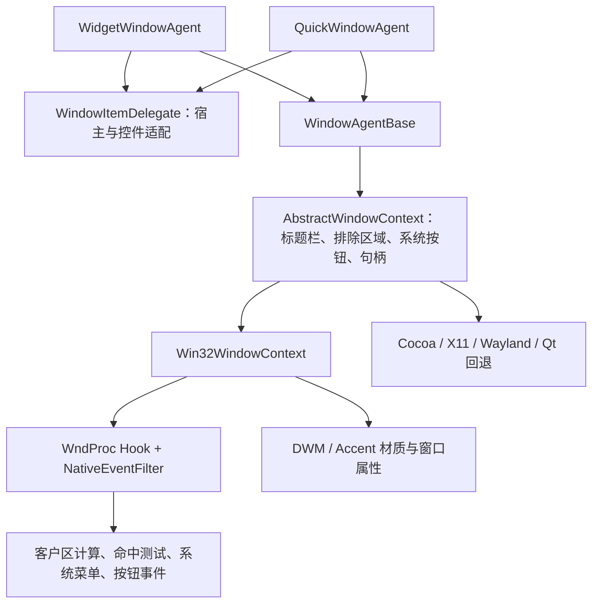
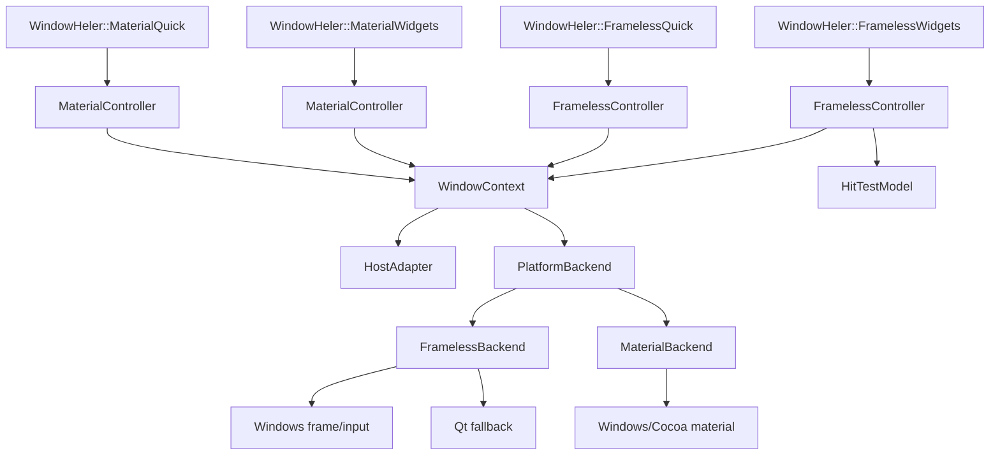
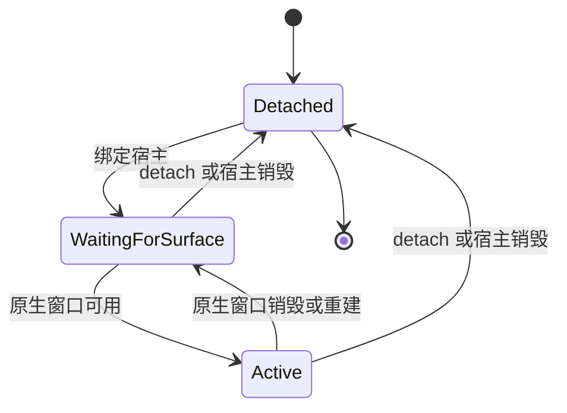

# 无边框模块重实现设计

版本：0.8 / WindowHeler 命名与 Runtime 动态库方案评审稿
日期：2026-11-18
参考项目：`D:\app\qwindowkit`，当前提交 `2072958`
正式项目名：WindowHeler。公共功能模块命名为 `WindowHeler::Frameless` 与 `WindowHeler::Material`。

本文是设计与实现边界文档；接口片段用于说明契约。当前工程已先完成 WindowHeler 命名、Runtime 动态库、四个前端 target、独立 Agent 和 Runtime 上下文注册表框架，具体平台行为仍按后续实现阶段逐步迁移。

## 1. 设计结论与范围

采用 **`WindowHeler::Frameless` + `WindowHeler::Material` 两个功能模块，加上 Widgets / Quick 前端适配层**。无边框行为与窗口材质不再作为一个不可拆分的 Core 能力交付；应用可以只链接其中一个模块，也可以同时链接两个模块。两类功能通过一个强制的 `WindowHelerRuntime` 动态库共享 WindowContext 和原生资源；功能模块及 UI 前端可以分别构建为静态库或动态库。Windows 原生消息处理按能力拆分，但同一窗口通过 Runtime 中的共享 WindowContext 协调，避免两个模块重复安装原生事件过滤器或互相覆盖窗口状态。

对应用的接入收敛为：**main 中统一初始化，然后绑定窗口、指定标题栏、按需选择材质**。仅在标题栏有交互控件或需要 Snap Layout 时，追加交互区域和最大化按钮注册。内部职责拆分不对应公共类数量。

用户已确认的要求：

| 要求 | 设计落点 |
|---|---|
| Qt 6.8+ | 移除 Qt 5 及早期 Qt 6 兼容分支 |
| C++20 或以上 | 最低标准确定为 C++20；后续可评估升级到 C++23，不要求消费端低于 C++20 |
| 静态库、动态库 | 同一源码，两套构建配置和独立安装目录 |
| Widgets + QML | 分别提供 `FramelessWidgetAgent` / `MaterialWidgetAgent` 与 `FramelessAgent` / `MaterialAgent` |
| 无边框窗口 | 自定义标题栏、拖动、缩放、窗口控制和原生交互 |
| 保留背景透明 | 显式区分像素透明窗口与系统材质窗口 |
| 保留模糊、云母质感 | Blur、Acrylic、Mica、Mica Alt；系统能力检测及降级 |
| 简化代码 | 删除过时兼容，减少重复逻辑，拆开消息、材质、UI 和构建责任 |
| 使用简单、接口尽量少 | 每个功能模块在每个 UI 前端提供一个 Agent；不提供组合 facade；隐藏控制器、后端、表面模式及兼容细节 |
| 统一初始化 | `WindowHeler::initialize(bool useQML = false)`；默认 Widgets，true 附加 QML/Quick 准备 |
| 当前先做设计 | 本轮交付设计与验收要求，工程实现另行开始 |
| 功能模块可选 | Frameless 与 Material 可单独链接，也可同时链接；不使用的功能不引入对应平台实现 |

为推进设计，暂作以下假设，均不视为用户已经确认：

- Windows 是首期主要平台；建议 Windows 10 1809+ 为基础运行范围，Windows 11 22H2+ 为完整现代材质验证范围。此处是产品基线建议，不是对所有 Qt 6.8+ 版本支持范围的承诺。
- macOS/Linux 保留后端扩展位置和 Qt 公共 API 基础回退，不将原生材质、系统按钮和系统菜单等价支持列入首期验收。
- “静态库 + 动态库”按两个发布包解释，不要求一次 configure 在同一目录生成两套同名 QML 插件。
- “高斯模糊”优先解释为窗口后方模糊；应用内部图像或控件模糊可作为独立 UI 组件，不混入窗口材质接口。

### 1.1 功能模块拆分决策

本次设计将“无边框窗口行为”和“窗口材质”定义为两个独立的功能模块。这里的“模块”包含公共 API、内部控制器、平台实现、CMake target 和安装组件，不只是把源码移动到不同目录。

| 模块 | 负责内容 | 不负责内容 |
|---|---|---|
| `Frameless` | 标题栏拖动、窗口缩放、最大化命中、系统菜单、窗口边框和对象交互区域 | DWM/Cocoa 材质、Alpha surface、背景透明策略 |
| `Material` | Transparent、Blur、Acrylic、Mica、Mica Alt、Alpha surface、背景管理、材质降级和恢复 | 标题栏拖动、缩放、Snap 命中和按钮事件桥接 |
| `Widgets` / `Quick` | QWidget、QQuickWindow、QQuickItem 的宿主适配和 QML 注册 | 具体平台策略；由 Frameless / Material 模块提供 |

目标依赖关系：

```text
FramelessWidgets ──> Frameless ──> Qt Core/Gui
FramelessQuick   ──> Frameless ──> Qt Core/Gui + Qt Qml/Quick

MaterialWidgets  ──> Material ──> Qt Core/Gui
MaterialQuick    ──> Material ──> Qt Core/Gui + Qt Qml/Quick

```

`Material` 不应为了复用宿主类型而反向依赖 `Frameless`；两个模块共同依赖的是内部宿主适配和窗口上下文抽象。若某个平台的材质实现必须依赖原生窗口句柄，只使用 Material 仍应能够绑定窗口并管理材质，但不得自动开启拖动、缩放或系统菜单。

同一窗口同时启用两个模块时，模块不能各自创建一套完整的后端。内部通过按宿主窗口索引的 `WindowContext` 共享：

```text
HostAdapter
    └── WindowContext（每个宿主窗口一个）
          ├── FramelessController（可选）
          ├── MaterialController（可选）
          └── PlatformBackend / NativeWindowBinding
```

`WindowContext` 只属于内部实现，不安装、不导出，也不作为应用 API。模块启用和释放采用引用计数或能力标记；只有最后一个能力模块解绑时才恢复本模块实际修改过的原生窗口属性。

### 1.2 Runtime 动态库决策

为解决多个功能 DLL 各自产生单例、注册表和 WindowContext 的问题，新增强制的 `WindowHelerRuntime` 动态库。Runtime 是所有功能模块的共同运行时 owner，**始终构建为 SHARED，不能被 `BUILD_SHARED_LIBS` 切换为静态库**。

Runtime 负责：

- `WindowContextRegistry`，按宿主窗口查找和创建唯一上下文；
- `WindowContext` 的引用计数、能力注册和销毁；
- 原生窗口句柄绑定、平台事件过滤器和统一生命周期；
- 跨动态库访问所需的稳定 C ABI / opaque handle；
- 不属于 Frameless 或 Material 的公共初始化和错误转发。

功能库不再内嵌 Runtime 的实现，也不得在各自 DLL 中定义同名的进程级 singleton。

建议产物关系：

```text
windowhelerruntime.dll       （始终动态）
        ↑
        ├── framelesswidget         （STATIC 或 SHARED）
        ├── framelessquick          （STATIC 或 SHARED）
        ├── framelessmaterialwidget （STATIC 或 SHARED）
        └── framelessmaterialquick  （STATIC 或 SHARED）
```

静态功能库的“静态”只表示功能代码被链接进最终应用；它们仍然必须链接并在运行时加载 `windowhelerruntime.dll`。因此静态 Frameless / Material 也不能脱离 Runtime 单独运行。

Runtime 的动态库类型与功能库的库类型独立：

| 组件 | 类型 | 是否受 `BUILD_SHARED_LIBS` 影响 |
|---|---|---|
| `WindowHeler::Runtime` | SHARED | 否，始终动态 |
| `WindowHeler::FramelessWidgets` | STATIC / SHARED | 是 |
| `WindowHeler::FramelessQuick` | STATIC / SHARED | 是 |
| `WindowHeler::MaterialWidgets` | STATIC / SHARED | 是 |
| `WindowHeler::MaterialQuick` | STATIC / SHARED | 是 |

Runtime 必须先于功能模块安装和部署。Windows 下至少包括 `windowhelerruntime.dll` 及其 import library；静态功能库的消费端也必须把 Runtime 的 DLL 放入应用运行目录或 PATH。

## 2. 原项目实现思路

原项目的主要调用链如下。依据见文末 S1—S7。



具体过程：

1. Agent 绑定宿主，通过平台工厂创建 Context，再注入 Widgets 或 Quick Delegate。
2. Context 保存标题栏、系统按钮和禁止拖动的交互对象。拖动区域由标题栏减去这些对象得到。
3. Windows 后端挂接 HWND 的窗口过程。`WM_NCHITTEST` 区分缩放边缘、标题栏、系统按钮和内容区域；`WM_NCCALCSIZE` 调整客户区，隐藏系统标题栏。
4. 原项目对消息处理次序进行了特殊协调：`WM_NCCALCSIZE` 先进入 Qt 原窗口过程，再由原生过滤器处理。不能把所有消息提前吞掉。
5. Snap Layout 需要非客户区按钮语义。原项目将部分非客户区输入转换回 Qt 客户区输入，并处理 hover、leave、抓取等状态。
6. 句柄变化后移除旧挂接、安装新挂接，并重新应用保存的窗口属性。
7. Windows 材质在同一后端文件中按字符串属性分支处理，涉及 DWM、Accent、客户区扩展及显示补丁。

当前 Windows 后端文件共 2,666 行，复杂度主要来自平台兼容、消息次序和渲染边界处理，不应按代码行数直接删除。原项目的共享上下文、Widgets/Quick 前端分层值得保留，但原 Core 需要按 Frameless / Material 能力拆分。

## 3. 保留与精简的边界

| 原项目内容 | 新设计处理 |
|---|---|
| UI 适配 + 共享窗口核心 | 保留，缩小适配接口 |
| 标题栏、交互区域、系统按钮注册 | 保留标题栏与交互注册；系统按钮只公开可选的最大化按钮绑定 |
| Windows 原生命中、客户区计算 | 保留，集中到 FrameController |
| HWND 重建与属性重放 | 保留，作为生命周期核心职责 |
| Snap Layout 及按钮状态协调 | 保留，独立 CaptionController |
| 模糊、Acrylic、Mica/Mica Alt | 保留，统一交给 MaterialController |
| Qt 5、Qt 6.8 之前兼容分支 | 删除；S3 中旧 custom margins workaround 在 Qt 6.7+ 已为空操作 |
| 多个材质布尔开关、字符串属性集合 | 换成一个互斥材质枚举和结构化结果 |
| 手工 QML 类型注册、示例 QML qrc 方式 | 改为标准 QML module 和自动类型注册 |
| 公开 virtual hook、通用 QVariant 属性总线 | 首版不提供，使用强类型属性与少量明确操作 |
| 全局窗口消息分发框架 | 缩到 Windows 后端内，公共接口不暴露 |
| Qt 私有符号与 QPA 依赖 | 逐项消除或隔离，不能先宣称全部不需要 |
| Windows 10 顶部边框绘制补丁 | 单独评估；优先公开绘制路径，通过实测再决定保留范围 |
| 独立主题管理系统 | 原生材质跟随可获取的宿主/应用配色，缺省跟随系统；首版不公开独立主题开关 |
| qmake/MSBuild 工程生成、多层构建包装 | 首版只提供 CMake package 与静态/动态 preset |
| macOS/Linux 完整原生实现 | 保留接口边界，按平台需求单独规划 |

原项目使用了 `QHighDpi`、`QWindowSystemInterface`、QPA 接口、Widgets 内部 `qt_button_down`，以及部分 Quick 私有接口。把这些直接复制进新项目，会把对应的版本耦合一并带过来。[S3、S5、S6]

设计目标是公共 API 优先。必须保留的私有适配放入对应功能模块的内部兼容单元，列清支持版本并设置构建检查；共享的句柄与事件边界集中在 WindowContext，不复制到各 UI target。是否可以完全去掉，要由消息桥接和渲染原型决定。

## 4. 新架构与依赖



### 4.1 发布 target

| target | 类型 | 公共依赖 | 功能 |
|---|---|---|---|
| `WindowHeler::Runtime` | **始终 SHARED** | Qt Core、Gui | WindowContext、Registry、原生句柄和跨 DLL ABI |
| `WindowHeler::FramelessWidgets` | STATIC / SHARED | Runtime、Qt Widgets | QWidget 无边框适配 |
| `WindowHeler::FramelessQuick` | STATIC / SHARED | Runtime、Qt Qml、Quick | QML/Quick 无边框适配 |
| `WindowHeler::MaterialWidgets` | STATIC / SHARED | Runtime、Qt Widgets | QWidget 窗口材质适配 |
| `WindowHeler::MaterialQuick` | STATIC / SHARED | Runtime、Qt Qml、Quick | QML/Quick 窗口材质适配 |

`WindowHeler::Frameless` 和 `WindowHeler::Material` 是对外的功能模块命名；由于 Widgets 与 Quick 必须保持独立依赖，实际 CMake 消费 target 使用带前端后缀的 `WindowHeler::FramelessWidgets`、`WindowHeler::FramelessQuick`、`WindowHeler::MaterialWidgets` 和 `WindowHeler::MaterialQuick`。这些 target 都不是组合 facade。

建议库文件名：

```text
windowhelerruntime.dll / windowhelerruntime.lib
framelesswidget       （静态库或 DLL）
framelessquick        （静态库或 DLL）
framelessmaterialwidget（静态库或 DLL）
framelessmaterialquick （静态库或 DLL）
```

`WindowHeler::Runtime` 是唯一允许持有进程级上下文注册表的 target。Core 不再作为应用可链接的发布 target，也不再把 Core OBJECT 文件复制嵌入多个功能 DLL。

依赖方向必须保持单向：

```text
FramelessWidgets  ──┐
FramelessQuick    ──┼──> WindowHeler::Runtime (SHARED)
MaterialWidgets   ──┤
MaterialQuick     ──┘
```

Frameless 与 Material 之间不直接依赖；应用需要同时使用两个功能时，分别链接两个功能 target，不能重新复制 Runtime 源码。

当 `BUILD_SHARED_LIBS=OFF` 时，功能 target 为静态库，但 Runtime 仍然是 SHARED：

```cmake
find_package(WindowHeler CONFIG REQUIRED COMPONENTS FramelessWidgets)
target_link_libraries(app PRIVATE WindowHeler::FramelessWidgets)
# WindowHeler::FramelessWidgets 自动传递 Runtime 的链接依赖；部署时仍需 windowhelerruntime.dll
```

当 `BUILD_SHARED_LIBS=ON` 时，功能 target 为动态库，同样依赖同一份 Runtime DLL。

### 4.2 依赖和共享上下文

`WindowContextRegistry`、`WindowContext` 和所有跨模块的全局状态只实现于 `WindowHeler::Runtime`。功能库只能通过 Runtime 导出的 opaque handle API 操作上下文：

```cpp
struct WindowHelerWindowContext;

WindowHelerWindowContext* windowheler_acquire_context(QObject* host);
void windowheler_retain_capability(WindowHelerWindowContext*, Capability);
void windowheler_release_capability(WindowHelerWindowContext*, Capability);
void windowheler_release_context(WindowHelerWindowContext*);
```

具体函数名和 `Capability` 类型在 ABI 评审时确定；公共头文件只提供不透明句柄和必要的 C/C++ 边界，不暴露 `WindowContext` 内部成员、STL 所有权或私有 Qt 容器。

依赖规则：

- Frameless 和 Material 都直接依赖 Runtime，不互相链接。
- Runtime 只加载一次，所有静态或动态功能库都访问同一份 Registry。
- 同一宿主窗口同时使用两个模块时，Runtime 返回同一个 Context。
- 原生消息过滤器、句柄绑定、平台事件订阅只由 Runtime 中的 Context 安装一次。
- Frameless 模块只注册命中、拖动、缩放和系统菜单能力。
- Material 模块只注册 surface、背景和 native material 能力。
- 只有使用 Material 时才链接材质平台实现；只有使用 Frameless 时不得启用材质能力。
- 功能 DLL 卸载前必须释放所有 Context handle；Runtime 在引用数归零后才恢复原生属性并销毁 Context。

应用可以只使用一个功能：

```cmake
find_package(WindowHeler CONFIG REQUIRED COMPONENTS FramelessWidgets)
target_link_libraries(app PRIVATE WindowHeler::FramelessWidgets)
```

也可以只使用材质：

```cmake
find_package(WindowHeler CONFIG REQUIRED COMPONENTS MaterialWidgets)
target_link_libraries(app PRIVATE WindowHeler::MaterialWidgets)
```

同时使用时显式声明两个组件：

```cmake
find_package(WindowHeler CONFIG REQUIRED
    COMPONENTS FramelessWidgets MaterialWidgets
)
target_link_libraries(app PRIVATE
    WindowHeler::FramelessWidgets
    WindowHeler::MaterialWidgets
)
```

以上三种方式都会自动依赖 `WindowHeler::Runtime`；区别只在应用最终链接的功能代码。

### 4.3 前端 API 形态

不再提供组合 API、组合 Agent 或 facade。新 API 按功能拆分：

```text
C++:
  FramelessWidgetAgent
  MaterialWidgetAgent

QML:
  FramelessAgent
  MaterialAgent
```

拆分后的 Agent 共享同一个窗口上下文，不允许分别创建两套原生后端。正式类名以 `WindowHeler::Frameless` / `WindowHeler::Material` 两个功能模块为归属，在 API 评审时最终确定。

## 5. 对象所有权与生命周期

- 一个宿主窗口最多对应一个由 `WindowHelerRuntime` 拥有的内部 `WindowContext`；同一窗口上的 Frameless / Material Agent 通过 Runtime 注册表共享它。
- 功能 Agent 只拥有自己的控制器引用或 Runtime 能力句柄，不拥有第二套原生后端，也不在本 DLL 内保存进程级 singleton。
- Widgets 构造时传入顶层 QWidget；Material-only 路径也必须使用同一套 QWidget 宿主适配，不能为了材质再创建隐藏窗口。
- QML 通过 `window` 属性绑定；窗口变化时，先释放旧 Agent 对上下文的能力引用，再绑定新窗口。
- 标题栏、按钮、交互对象只保存弱引用，不接管业务 UI 所有权。
- 注册对象必须属于绑定窗口；拒绝跨窗口对象。销毁、换父对象、换窗口后重新校验。
- 所有公开配置以及内部命中、材质和平台操作发生在 GUI 线程，不从 Quick 渲染线程操作 GUI 对象。
- Frameless 只恢复自己修改的窗口 flags、光标和输入状态；Material 只恢复自己修改的 surface、背景和 native material 属性。
- 当一个模块解除绑定而另一个模块仍在使用窗口时，不得拆除共享句柄、事件过滤器或对方持有的原生状态。



每次绑定原生句柄分配 generation，延迟回调携带 generation，防止旧句柄消息影响新窗口。重建时清除旧按钮状态与原生资源，但保留用户的区域注册和材质请求；新句柄就绪后重新执行 frame → material → state 同步。

通过宿主事件及 `QPlatformSurfaceEvent` 协调句柄创建、销毁；QWidget 路径同时处理 `WinIdChange`。销毁处理内禁止为了查询而再次调用可能创建句柄的 API。

detach 仅恢复本模块确实改动、且仍由本模块持有的原生状态。其他库可能也修改窗口样式，因此不能无条件覆盖整个样式字。

detach 是内部清理操作，首版不提供逐窗口 attach / detach / setup / prepare / initialize。仅提供第 10.3 节的命名空间级 initialize 统一启动入口。Widgets Agent 构造绑定后不换宿主；QML window 属性变化时，内部先清理旧绑定再绑定新窗口。对象析构和宿主销毁自动收尾。

动态库卸载前必须解除所有窗口绑定、原生回调和静态注册资源；首版按进程存续期加载使用，不承诺运行中任意热卸载。

## 6. 命中测试与窗口行为

UI 命中使用窗口客户区逻辑坐标 `QPointF`。原生边框尺寸使用物理像素，由后端在边界处转换；绝不能直接把桌面绝对坐标除以 DPR。

Windows 输入先从有符号屏幕坐标转换到 HWND 客户区物理坐标，再转换到 Qt 逻辑坐标。测试必须覆盖左侧屏幕负坐标、125%/150% 缩放及跨屏 DPI 变化。

HostAdapter 只提供必要能力：窗口访问、状态/尺寸限制、宿主操作、对象所属窗口及点命中、透明表面准备。无需延续原 Delegate 的完整接口集合。

Widgets 适配通过对象映射和可见区域判断；Quick 适配把场景点反向映射到 Item 局部坐标，再调用包含判断并检查祖先裁剪。不能仅用“左上角 + size”的轴对齐矩形代替旋转、缩放后的实际命中。[S6]

建议优先级：

| 顺序 | 条件 | 处理 |
|---|---|---|
| 1 | 非活动绑定、模态/弹出交互需要优先处理 | 交还既有消息链，避免抢走弹出层输入 |
| 2 | 全屏 | 全部客户区；禁用标题栏拖动、缩放及系统按钮命中 |
| 3 | 普通状态可缩放的边缘/角落 | 返回对应缩放命中，保留尺寸约束 |
| 4 | 已注册的有效最大化按钮 | 进入 Snap/按钮控制路径 |
| 5 | 已注册的交互区域 | 客户区，交给 Qt 输入系统 |
| 6 | 标题栏剩余区域 | 标题栏命中，由系统处理移动及双击行为 |
| 7 | 其余内容 | 客户区 |

最大化时禁用缩放边缘，仍可允许标题栏拖动还原；固定宽或固定高分别屏蔽对应方向。按钮布局应避开预留的缩放带，避免同一像素承担冲突行为。

交互区域 API 为 `setInteractive(widget, bool interactive = true)`；QML 对应 `interactiveItems` 列表。含义是“该对象及其区域正常接收 Qt 输入，不能作为拖动区”。可登记一个容器排除其整个区域，无需逐个登记其中按钮。禁用但仍可见的控件默认继续占据交互区域，避免点击禁用按钮意外拖动窗口。已绑定的最大化按钮自动排除，不需要重复登记。首版不通过控件名称或类型猜测所有交互区域。

Qt 回退路径使用 `startSystemMove()` / `startSystemResize()`，检查返回值并暴露不支持状态，不手写持续 move/resize 循环。Qt 官方文档明确这些操作依赖平台支持。[Q1]

## 7. Windows 消息处理

首选以每 HWND 的原生绑定管理消息链；可优先验证 `SetWindowSubclass` / `DefSubclassProc`，保留 Qt 原窗口过程。是否采用须通过 Qt 6.8 的消息次序原型验证，不能把它当成已经验证的替换方案。

| 消息或事件 | 责任 | 约束 |
|---|---|---|
| `WM_NCCALCSIZE` | 客户区计算 | 与 Qt 默认处理次序协调；普通、最大化、全屏分别处理 |
| `WM_NCHITTEST` | 命中结果 | 物理/逻辑坐标边界明确，尊重窗口能力 |
| `WM_NC*` 鼠标消息 | CaptionController | 最大化按钮系统语义、hover/pressed/leave |
| `WM_GETMINMAXINFO` | 尺寸约束协调 | 保留 Qt 已处理的信息，必要时补充，不一概替换 |
| `WM_DPICHANGED` | DPI 变化通知 | 不抢走 Qt 的默认 DPI 更新；刷新边框和命中状态 |
| `WM_SYSCOMMAND` / 系统菜单 | 窗口命令 | 尊重最小化、最大化、关闭的可用状态 |
| 主题、激活、系统设置变化 | 材质刷新 | 合并重复更新，避免每个消息重做所有配置 |
| `WM_NCDESTROY` / surface 销毁 | 解除绑定 | 失效旧句柄及回调，正常续传销毁消息 |

正常窗口建议保留原生厚边框语义和系统阴影，移除原生标题栏。最大化按显示器工作区计算，验证自动隐藏任务栏；全屏不套用普通最大化的补偿公式。

挂接和重建时记录并维持约定的客户区尺寸，避免取消标题栏后把原非客户区高度加入内容区；同时验证 geometry、frameGeometry、normalGeometry 与 Qt 窗口状态保持一致。切换 frame 策略不能产生位置漂移。

原项目的 `WM_NCCALCSIZE`、消息转发、按钮抓取与边框补丁都有可观察的边界问题依据。首版须先用小原型验证再替换，不能仅凭“Qt 6.8 更新了”删除所有补丁。[S3、S5、S7]

## 8. Snap Layout 与标题栏按钮

将按钮的绘制、命中角色、窗口命令分开。原项目的非客户区输入转发很复杂，原因是 Qt 按钮仍需要正确的 hover/pressed/release 状态。[S3]

首版只公开一个可选入口：Widgets `setMaximizeButton(button)`，QML `maximizeButton` 属性。支持范围先限定为 Widgets 的 QAbstractButton 系列，以及 QML 基于 Qt Quick Controls AbstractButton 的按钮；后者是消费应用的 UI 选择，不把 Quick Controls 的 C++ 私有类型暴露到模块接口。

不再提供独立 CaptionButton 公共类、ButtonRole 注册体系或 Normal/Native 模式开关。应用保留原按钮及其标准 hover、pressed、键盘和无障碍行为，内部 CaptionController 完成非客户区事件适配。

绑定最大化按钮的设计目标是启用 Snap Layout；命中时提供 `HTMAXBUTTON` 语义，并让需要的消息继续经过系统默认处理。微软对自定义 Win32 标题栏明确列出了最大化/还原按钮的这一命中要求。[M2] 未绑定时仍可用普通 Qt 最大化按钮，但不承诺该按钮上的 Snap 弹出。

窗口命令沿用应用已有的 Qt clicked / onClicked 处理。绑定只负责命中和输入桥接，不额外连接一次最大化命令。鼠标按钮序列经桥接交给原按钮执行一次；同一序列对应的原生默认最大化命令须抑制。系统菜单、Snap 操作及其他独立原生命令则继续正常处理。该分工必须用原型验证，不能只返回 HTMAXBUTTON 就宣称完成。

按钮控制器至少包含 Idle、Hovered、Pressed 状态；失焦、取消、窗口隐藏、句柄销毁或鼠标抓取变化都重置。按下后移出、再移回、在外部释放必须有确定行为。

首版不承诺任意第三方自绘控件、MouseArea 或 PointerHandler 组合都能作为最大化按钮。接口只接收上述约定范围；不支持的对象报告错误且保持客户区输入，避免半接管状态。业务仍使用自己的按钮样式，不需要继承本模块的新按钮类型。

最小化、关闭按钮可继续使用客户端 Qt 输入；无需为了 Snap Layout 把全部按钮都变成非客户区按钮。

## 9. 透明与材质设计

### 9.1 三类视觉能力

| 能力 | 作用对象 | 接口与限制 |
|---|---|---|
| 像素透明 | 窗口自身的背景像素 | 保持内容不透明；不等于整个窗口 opacity 降低 |
| 系统背景材质 | 窗口背后的系统合成背景 | Blur、Acrylic、Mica、Mica Alt；受系统能力和策略影响 |
| 应用内部模糊 | 某个图片、纹理或 Item | 独立组件；不能直接获得其他应用窗口的实时图像 |

`QQuick MultiEffect` 对指定 source Item 做后处理，应放在内部内容效果组件中，不当作系统背景模糊实现。[Q4]

材质枚举建议为：

```cpp
enum class Material {
    Solid,
    Transparent,
    Blur,
    Acrylic,
    Mica,
    MicaAlt
};
```

一次只能请求一种材质。系统模糊接口不承诺可调高斯半径；若产品要求精确 blurRadius，应单独定义内容模糊功能并选择相应算法。

### 9.2 内部表面策略

内部保留 `SurfaceMode { NativeBackdrop, PerPixelAlpha }` 以正确实现透明和系统材质，但不进入公共头文件或 QML 属性。Agent 根据宿主、初始 Material 和平台能力自动选择。

| 模式 | 用途 | 初始约束 |
|---|---|---|
| NativeBackdrop | 原生边框、阴影、Blur/Acrylic/Mica | 选择兼容系统合成的表面和绘制策略 |
| PerPixelAlpha | 任意形状、像素透明背景 | Windows Widgets 公开透明路径需要相应窗口属性及 FramelessWindowHint；原生效果须逐项检测 |

Qt Widgets 的 `WA_TranslucentBackground` 公开路径和保留原生框架的 DWM 材质路径不能直接视为相同；Qt 官方文档对 Windows 透明窗口列出了 FramelessWindowHint 要求。[Q2]

用户只需在首次显示前绑定 Agent 并设置初始 material，Agent 在首次表面创建前完成策略选择。运行时切换在当前表面兼容时直接生效；若必须重建原生表面，首版不隐式重建窗口，内部记录 RequiresSurfaceRecreation，公开 effectiveMaterial 反映实际降级结果，并通过统一错误信号说明原因。需要跨此边界的应用可按普通 Qt 生命周期重新创建窗口，并在首次显示前设置目标 material，无需了解 SurfaceMode。

不能因不公开表面模式而假定所有材质均可任意互切。该限制在使用说明和材质切换验收中明确。窗口自身因 Qt 原因重建时，模块自动恢复已有请求。

Quick 的全局 Alpha 默认值由 WindowHeler::initialize(true) 内部调用 QQuickWindow::setDefaultAlphaBuffer(true) 准备，必须早于首个 QQuickWindow 创建，这是 Qt 对预期创建透明 Quick 窗口的前置要求。[Q5] Window 内的 Agent 创建晚于该 Window，不能用 Agent 的自动初始化掩盖这个时间边界。统一调用顺序为 application 构造之后、QQmlApplicationEngine 及窗口创建之前；应用不再直接设置 Alpha 默认值。

有了该前置条件，Agent 再处理单窗口表面验证、底色和材质，窗口及覆盖内容按需透明；不得通过降低整个窗口 opacity 实现材质。库不修改进程级渲染后端环境变量，也不替应用选择 D3D/OpenGL。

### 9.3 材质后端

WindowsMaterialBackend 内部分为两条路径：

1. DWM 路径：现代 Acrylic、Mica、Mica Alt，优先使用 SDK 定义与系统正式接口。
2. LegacyAccent 路径：兼容原项目窗口后方 Blur；隔离 `SetWindowCompositionAttribute` 与 AccentPolicy，编译可选，在用户显式请求 Blur 时按能力使用，并进行符号检测。不再公开额外的运行时兼容开关。

原项目的 `dwm-blur` 在 Windows 8+ 使用 AccentPolicy，而较老分支才调用 `DwmEnableBlurBehindWindow`；原项目 Mica 在 Windows 11 22H2+ 使用 `DWMWA_SYSTEMBACKDROP_TYPE`，较早 Windows 11 使用旧属性。[S4]

建议首版仅对现代 DWM 路径作稳定支持承诺；旧 Windows 的 Accent 功能保留为兼容能力，失败时有明确状态与纯色替代。Windows 11 首版旧 Mica 属性不必继承。

设计映射：Mica → MAINWINDOW，Acrylic → TRANSIENTWINDOW，MicaAlt → TABBEDWINDOW。微软文档已核对该映射，并将 DWM_SYSTEMBACKDROP_TYPE 的最低客户端列为 Windows 11 Build 22621。[M1] 文档同时指出材质外观可能随系统版本演进；接口应按材质语义配置，不保证像素外观永远一致。不能把“属性设置成功”等同于“当前一定呈现模糊”。

### 9.4 状态、失败和切换

完整状态仅在内部保存，对外保留一个请求属性、一个结果属性和一个通用错误信号：

| 信息 | 可见性与用途 |
|---|---|
| material | 公共读写；用户请求的材质，失败后也保留 |
| effectiveMaterial | 公共只读；后端已经成功配置的材质，不是屏幕像素效果保证 |
| errorOccurred(message) | 公共可选订阅；异常绑定、配置失败或材质降级说明，正常接入不必订阅 |
| requested / applied / pending | 内部状态，支持延迟应用和重放 |
| materialStatus / fallbackReason | 内部状态与分类日志，不分别公开属性 |
| supportedMaterials / SurfaceMode | 内部能力判断，调用方不必先查询再设置 |
| fallbackColor / theme | 内部默认策略，跟随宿主可获取配色，缺省使用应用/系统配色 |

effectiveMaterial 在成功应用新状态后通知；初始化尚未应用期间保持上一次确定值，初值为 Solid。错误同时写入分类日志并合并重复通知，避免系统事件导致日志刷屏。正常操作不要求调用方维护一个“初始化状态机”。

材质切换采用固定顺序：保存新请求 → 校验能力 → 清理旧效果及其边距 → 应用新效果 → 成功后更新状态；失败则完整清理并配置明确的 fallback。先取消旧 DWM/Accent 状态，避免多种机制同时残留。

首版固定降级到 Solid，不公开有序 fallback 列表或独立 fallbackColor 设置。缺省背景跟随宿主可获取配色，无法获取时使用应用/系统配色。不要默认把 Mica 降级到更透明的 Acrylic，这可能改变可读性和背景遮挡程度。

系统主题、透明效果策略、远程会话等变化触发重新评估。仅对可检测的变化提供原因；系统内部降级不能可靠观测时，不虚报当前视觉效果。

原生材质主题自动跟随宿主可获取的配色变化，缺省跟随应用/系统；首版不公开独立 theme 设置，也不修改全应用 `QStyleHints`、QPalette 或 Quick Controls style。

## 10. 最小公共 API

以下是设计接口，不是现有可调用 API。提供一个轻量公共初始化入口，以及按功能拆分的 Agent；不提供组合 Agent 或组合 facade。导出类保留 PIMPL。业务配置限定为下表，不为内部每项能力增加设置函数。

| 用途 | `WindowHeler::Frameless` API | `WindowHeler::Material` API | 必要性/默认值 |
|---|---|---|---|
| 统一初始化 | `initialize(bool useQML = false)` | `initialize(bool useQML = false)` | 仍只保留一个公共入口；Material 不得隐式启用 Frameless，材质准备在 Material Agent 绑定时完成 |
| 绑定宿主 | `FramelessWidgetAgent(QWidget *)` | `MaterialWidgetAgent(QWidget *)` | 必需；同一窗口共享 WindowContext |
| QML 绑定宿主 | `FramelessAgent.window` | `MaterialAgent.window` | 必需；显式指定窗口 |
| 指定拖动区域 | `setTitleBar(QWidget *)` / `titleBar` | 不提供 | 仅 Frameless 能力 |
| 保留控件交互 | `setInteractive(QWidget *, bool)` / `interactiveItems` | 不提供 | 仅 Frameless 能力 |
| Snap 最大化按钮 | `setMaximizeButton(QAbstractButton *)` / `maximizeButton` | 不提供 | 仅 Frameless 能力 |
| 背景效果 | 不提供 | `setMaterial(Material)` / `material` | 仅 Material 能力；默认 Solid |

QML maximizeButton 属性以 QQuickItem 指针承载，但公开契约只支持第 8 节规定的标准按钮，不把任意 Item 都视作可桥接按钮。

读回与通知只保留各模块配置所需的常规 getter/属性通知。Material API 提供只读 `effectiveMaterial`；两个模块均可提供通用 `errorOccurred(message)` 信号，但错误归属必须明确标注为 Frameless 或 Material。常规 getter/NOTIFY 不代表新增的业务能力。无需公开 ready、状态枚举、能力列表或多个错误查询函数。

完成 main 的统一初始化后，Widgets 每窗口常用接入只需三行；假定 window 和 titleBar 已由应用创建：

```cpp
auto *frame = new WindowHeler::FramelessWidgetAgent(window);
frame->setTitleBar(titleBar);

auto *material = new WindowHeler::MaterialWidgetAgent(window);
material->setMaterial(WindowHeler::Material::Mica);
```

以上配置放在首次 `window->show()` 前。仅需无边框而不需要特殊背景时省略第三行。需要保留交互和 Snap 时再补充：

```cpp
frame->setInteractive(searchEdit);
frame->setMaximizeButton(maximizeButton);
```

QML 最小接入示意：

```qml
import QtQuick
import WindowHeler

Window {
    id: root
    width: 800
    height: 600
    visible: true

    FramelessAgent {
        window: root
        titleBar: bar
    }

    MaterialAgent {
        window: root
        material: MaterialAgent.Mica
    }

    Item {
        id: bar
        width: parent.width
        height: 36
    }
}
```

标题栏有输入框或按钮时，在 Agent 中增加 `interactiveItems: [searchBox, buttonContainer]`；需要 Snap 时增加 `maximizeButton: maximizeButtonItem`。不要求 Component.onCompleted 中手动 setup，也不要求 visible 绑定一个 ready 属性。

### 10.1 自动管理与使用约定

- 生命周期自动管理：Widgets 构造先建立逻辑绑定及事件监听，不为初始化而过早强制创建原生表面；QML 在组件完成阶段收集声明配置。Agent 在首次显示/表面创建的合适阶段完成应用，已有原生表面则按兼容性处理。材质失败时窗口仍可正常显示。首次显示次序、背景设置及无闪烁行为必须通过两种 UI 的原型验证。
- 背景自动管理：在宿主已调用 initialize 并满足第 9.2 节 Quick 前置条件后，请求非 Solid 材质时，Agent 负责窗口底色、单窗口透明准备和 fallback 绘制。QML 的 Window.color、Widgets 的窗口背景由该功能接管，应用不要同时对同一背景属性施加冲突绑定或绘制；业务面板仍可独立绘制背景。首版不公开 backgroundColor / fallbackColor。
- 背景所有权有限：只管理宿主背景及本模块创建的底层绘制对象，不修改子控件样式或全应用调色板。首次接管保存原值，在仍拥有该背景配置时恢复。默认 Solid 且未启用材质时保留原窗口背景。
- 材质区域需要可见：业务面板自身不透明时会遮挡材质，模块不递归把所有控件改成透明。示例应展示内容区如何按需留出透明区域。
- 配置可撤销：setTitleBar(nullptr) 取消拖动区域；setInteractive(widget, false) 移除该注册；setMaximizeButton(nullptr) 清除按钮绑定。QML 通过属性和列表更新表达同样含义。对象销毁自动清理弱引用。
- 重复设置同一值不重复安装过滤器或更新系统材质；替换标题栏时保留同窗口仍有效的对象注册并重新判断区域，跨窗口对象报错。

### 10.2 不新增的接口

最小化、最大化/还原、关闭继续使用 QWidget/QWindow 及 QML Window 已有接口；应用按钮保持原 clicked / onClicked 逻辑。模块不再包装 minimize、maximize、close。原生关闭路径仍需让宿主 Qt closeEvent / QML closing 有机会拒绝，不能直接销毁 HWND。

标题栏右键菜单、键盘系统菜单、双击最大化、拖动还原由内部保持原生行为，不额外提供公开 showSystemMenu 或 toggleMaximized。

首版不公开 Controller/Backend/HostAdapter、SurfaceMode、attach/detach/setup/prepare、resizeBorderWidth、DPI 换算、enableSnapLayout、theme、fallback 链或 native-message 回调。平台细节与诊断走内部策略和分类日志。将来增加接口必须对应已存在的业务需求，且不能由 Qt 原有接口或当前配置表达。

### 10.3 main 的初始化责任

按用户要求，增加唯一的公共启动入口，拟放在轻量公共头 Initialization.h：

```cpp
namespace WindowHeler {
    void initialize(bool useQML = false);
}
```

统一时序：**构造 QApplication/QGuiApplication → initialize → 创建业务窗口、Agent 或 QQmlApplicationEngine → 显示/加载**。在 GUI 主线程调用；不要求调用方在 application 构造前调用。

| 场景 | 调用 | 行为 |
|---|---|---|
| Widgets | initialize() 或 initialize(false) | 建立公共运行时状态、应用生命周期清理和公共默认策略 |
| QML/Quick | initialize(true) | 完成公共初始化，并准备 Quick Alpha 默认值 |
| Widgets + QML | QApplication 之后 initialize(true) | 两种前端共存，true 不禁用 Widgets |

useQML 只决定是否附加 Quick 初始化；不创建 application/engine，不指定 Quick Controls style，不强制 RHI 后端，不修改垂直同步或调试环境变量。[S9] HWND 表、原生过滤器和材质资源仍由内部按实际窗口需要创建，调用方不传入任何内部数据。

重复调用契约：

- 相同状态重复调用幂等，不重复创建资源或注册事件过滤器；已成功初始化后重复调用不重新检查“窗口必须尚未创建”。
- false→true 时只补充 Quick 初始化，并要求首个 QQuickWindow 尚未创建；已有公共状态保留。
- true→false 不撤销 Quick 初始化，也不关闭 Alpha，false 不是关闭开关。
- 首次调用过晚、线程/application 不满足条件，或未提供 Quick 支持却请求 true，属于初始化错误。明确写入分类日志，调试构建可断言；不静默声称成功。初始化不抛出跨 DLL 异常。
- Agent 检查所需运行时状态；漏调用 initialize 不隐式补做可能已经过晚的 Quick 初始化，而通过既有 errorOccurred 和日志报告。无需另增 isInitialized、shutdown 或分阶段初始化函数。

统一入口不能让纯 Widgets 消费者被迫链接 QtQuick。公共运行时与可选 Quick 初始化适配须分离，由所选 CMake target 完成内部接入，不要求应用注册回调。静态库裁剪、DLL 加载顺序及混合前端下的单一运行时状态列为实现前必须验证的链接原型；不得靠 QML 插件在 engine 加载时才安装所需初始化能力。

QML 类型仍由标准模块注册；静态插件的链接/导入由构建及消费说明处理。initialize(true) 统一启动行为，但不能补救缺失的插件链接或模块部署。

## 11. 静态库、动态库与 QML 发布

### 11.1 C++ 标准与接口约束

项目以 **C++20 为最低语言标准**，Core、Widgets、Quick、示例与测试保持一致。C++23 可作为额外构建验证配置；在正式提升最低标准之前，发布代码及公共头文件不得强制依赖 C++23 特性。

构建要求通过公开 target 的 `cxx_std_20` 编译特性传递给消费端；项目默认标准设为 20、要求标准满足并禁用编译器语言扩展。消费端可以选择更高标准，但仍须使用兼容的工具链和 Qt 构建。所有独立安装消费测试也按 C++20 基线执行。

C++20 的使用以简化实现为目的：适合时使用 concepts 约束内部模板、用 ranges 表达简单集合操作、用 constexpr 定义静态映射。首版不引入 C++ Modules 或协程作为必需依赖；窗口控制仍遵循 GUI 线程和 Qt 对象生命周期模型。

公开 QObject 接口与 QML 属性优先使用明确枚举、Qt 类型及非模板方法，避免把实现模板暴露给应用。借用视图不得跨异步回调保存；异步工作需要独立拥有的数据或可校验的弱引用。C++20 不替代 DLL 导出、PIMPL 和二进制兼容策略。

### 11.2 构建与交付

同一源码以 `BUILD_SHARED_LIBS=OFF/ON` 生成两套功能包，建议 presets 为 static-release、shared-release，使用不同 build/install 根目录。两套包都必须包含同版本的 `WindowHelerRuntime` 动态库；`BUILD_SHARED_LIBS` 只控制功能库，不控制 Runtime。Qt 6.8 的库类型选择仍需明确 CMake policy 或显式 STATIC/SHARED，避免跟随 Qt 自身构建类型产生意外结果。[Q3]

| 项目 | 静态包 | 动态包 |
|---|---|---|
| `WindowHeler::Runtime` | **始终 SHARED DLL + import library** | **始终 SHARED DLL + import library** |
| Frameless / Material / 前端 targets | 静态库 | DLL + import library |
| QML 插件 | 静态插件，消费端正确链接并导入 | 插件 DLL 与 QML module 元数据 |
| QML module | `qt_add_qml_module` 生成注册与元数据 | 同左 |
| 消费方式 | CMake target 链接 | CMake target 链接或 QML 插件加载 |
| Qt 运行库 | 取决于 Qt 自身链接方式 | 取决于 Qt 自身链接方式 |

本模块静态不意味着 Qt 静态，更不意味着单文件部署。动态库包需要匹配编译器、体系结构、Qt 配置和运行库；“Qt 6.8+”先定义为源码支持范围，二进制包按验证过的工具链发布。

公共头文件使用生成的 export 宏；构建 DLL、消费 DLL、静态库三个条件必须区分。静态宏由导出的 CMake target 自动传播。

QML 每个功能模块分别使用 backing library；静态消费者必须链接实际使用的 Quick 功能 target；不能因为链接 FramelessQuick 就自动获得 Material QML 类型，反之亦然。[Q3]

安装包至少包含 Runtime 动态库及其 ABI 头、按组件选择的功能库、Config/Version/Targets CMake 文件，以及实际启用模块对应的 QML qmldir、qmltypes、插件和资源。即使功能库选择静态链接，Runtime DLL 也必须安装和部署。只安装 Frameless 时不应出现 Material 平台库或 Material QML 元数据；只安装 Material 时不应出现 Frameless 功能 target。静态/动态功能库不能同时加载到一个进程形成两份相同能力；Runtime 必须保持同版本且只加载一份。不同版本的 Runtime 不允许在同一进程并存。

首版不复用一份 OBJECT library 同时生成静态和动态版本：导出宏、插件注册与编译定义不同，独立构建更容易验证。

构建开关控制在少量明确项：BUILD_SHARED_LIBS、BUILD_FRAMELESS、BUILD_MATERIAL、BUILD_WIDGETS、BUILD_QUICK、BUILD_EXAMPLES、BUILD_TESTING、ENABLE_LEGACY_ACCENT。`BUILD_FRAMELESS` 与 `BUILD_MATERIAL` 可以分别关闭；材质种类仍是运行时配置，不为每种效果新增 CMake 开关。若关闭某个功能模块，对应平台实现、公共组件和安装组件都不得生成。

## 12. 建议代码组织

代码组织必须反映两个可选功能模块，而不是继续把所有实现放入名为 Core 的单一单元。

| 模块 | 内部单元 | 说明 |
|---|---|---|
| 公共基础 | `Initialization`、`Material` 枚举、错误类型、导出宏、Runtime ABI 头 | 只保留无功能偏向的轻量公共内容；Runtime ABI 头只暴露 opaque handle |
| Frameless | `FramelessController`、`HitTestModel`、拖动/缩放、系统菜单、窗口 flags | 不包含 MaterialController、DWM/Cocoa 材质实现 |
| Material | `MaterialController`、surface 生命周期、背景管理、材质降级 | 不包含标题栏命中、拖动、缩放和 Snap |
| Runtime | `WindowContext`、`WindowContextRegistry`、HostAdapter 边界、句柄生命周期、C ABI | **始终 SHARED**；所有模块共享；只建立一套平台事件和原生绑定 |
| Frameless 平台后端 | `FramelessBackend`、Windows frame/input、Qt fallback | 只在 Frameless 模块启用 |
| Material 平台后端 | `MaterialBackend`、Windows DWM、Cocoa material、Material fallback | 只在 Material 模块启用 |
| Widgets | `FramelessWidgetAgent`、`MaterialWidgetAgent` | 只依赖 Qt Widgets 和所选功能模块 |
| Quick | `FramelessAgent`、`MaterialAgent`、QML 注册 | 只依赖 Qt Qml/Quick 和所选功能模块 |
| Examples | Frameless-only、Material-only、Frameless+Material 三类示例 | 明确展示独立链接和同时链接两个功能模块 |
| Tests | 功能隔离、共享上下文、静态/动态安装消费 | 覆盖只用一个模块和同时使用两个模块 |

禁止以下拆分方式：

- 只增加 CMake alias，但两个 target 仍编译并链接同一份完整材质和无边框实现。
- 让 Material target 通过链接 Frameless target 获得隐式拖动、缩放或系统菜单。
- 让两个模块各自创建 `PlatformBackend`、原生事件过滤器或 HWND 绑定。
- 把 Runtime 编译成 OBJECT 或 STATIC 后分别嵌入 Frameless / Material DLL；这会重新产生多份 Registry。
- 为了复用代码，把内部 `WindowContext`、`HostAdapter` 或 Controller 安装为公共头文件。
- 通过运行时环境变量决定模块是否存在；模块选择应在 configure/link 阶段可见。

不保留旧版组合 Agent 迁移 facade；新代码必须使用功能明确的 Agent。

## 13. 实现前必须验证的技术点

这些验证属于后续实现阶段；本轮没有运行原型或 GUI 验收。

| 技术点 | 最小验证 | 决策依据 |
|---|---|---|
| 消息链 | Widgets/Quick 各一个窗口，验证 NCCALCSIZE 与原生过滤器次序 | 确定 subclass 是否可用、是否需窄范围兼容桥 |
| 透明表面 | 两个 UI 前端验证 Material 自动选择内部表面及背景管理 | 明确各材质支持表、首次显示次序、跨模式降级 |
| Snap Layout | 标准最大化按钮验证悬停、按下移出、系统命令、键盘操作 | 确定事件桥接与命令唯一执行，保留原控件输入状态 |
| Windows 10 边框 | 普通/最大化、DPI 125%、连续缩放 | 决定是否保留绘制补丁及适用后端 |
| Qt 私有依赖 | 公共 API 原型对照旧实现的边界用例 | 决定兼容单元的必要性，而非预设永久保留 |
| QML 静态导入 | 安装后用独立最小应用 import module | 防止只在源码树示例中可用 |
| 统一初始化链接 | Frameless-only、Material-only、同时使用 Frameless+Material；Widgets/Quick；静态/动态各验证 | 单模块不引入另一模块；同时使用时只创建一套 WindowContext、原生过滤器和初始化状态 |
| 模块隔离 | 分别关闭 BUILD_FRAMELESS / BUILD_MATERIAL，检查 configure、链接和安装清单 | 关闭模块后对应 target、平台代码、头文件和 QML 元数据均不可见，但 Runtime 仍按包要求生成 |
| Runtime ABI | 静态功能库、动态功能库分别消费同一 Runtime；检查 DLL 加载和符号解析 | Runtime 始终为 SHARED；功能库类型切换不复制 Registry 或上下文 |
| 共享窗口上下文 | 同一窗口先绑定 Frameless 后绑定 Material，以及反向顺序；分别释放 | 不重复安装 native filter；任一模块释放不破坏另一模块；最后释放才恢复属性 |

建议实施顺序：基础绑定与命中 → Windows frame 与生命周期 → 两个 UI 示例 → 材质与失败恢复 → Snap 按钮与可访问性 → 包安装与自动验证 → 删除不再需要的兼容代码。

## 14. 验收标准

| 维度 | 必须覆盖 |
|---|---|
| 构建 | Runtime SHARED × 功能库 STATIC/SHARED × Frameless/Material × Widgets/Quick；关闭任一功能模块时不生成对应功能产物 |
| 消费 | 安装目录独立 CMake 消费；动态 QML 加载；静态 QML 导入 |
| 易用性 | Frameless-only、Material-only 和 Frameless+Material 均可独立接入；不提供组合 API；不要求应用链接 Core |
| 初始化 | 默认 false、true、相同配置重复、false→true、true→false、漏调用和错误时序；Widgets/Quick/混用行为符合契约 |
| 几何 | 八方向缩放、固定单轴、尺寸限制、最大化、全屏、跨屏、负屏幕坐标 |
| 标题栏 | 交互控件不拖动；双击最大化/还原；系统菜单；弹出菜单关闭后输入正常 |
| 按钮 | Snap 弹出、按下移出与取消、键盘、无障碍、命令不重复 |
| 生命周期 | 关闭再显示、宿主销毁、句柄重建、换标题栏、对象删除、多窗口分别关闭；两个模块的绑定顺序和独立释放；Runtime 引用归零后的清理 |
| 材质 | Material-only 和 Frameless+Material 下覆盖每种请求、每种失败、兼容材质连续切换、跨表面降级、重建恢复、配色跟随；effectiveMaterial 与结果一致 |
| 视觉 | 透明不影响文字；无黑底、残留旧效果、异常边距；缩放无明显白边/闪烁 |
| 渲染 | Widgets raster、Quick D3D11 为首期基准；其他 RHI 后端单独验证并标记支持状态 |

自动化覆盖纯逻辑和消费测试；Snap 弹出、材质视觉、任务栏和系统策略需要真实 Windows 环境验收。不能用单元测试通过替代视觉及系统交互验证。

没有以“总代码必须少于 N 行”为验收标准。精简是否成功，应看 Qt 版本分支是否消失、私有依赖是否集中、材质是否互斥、窗口行为是否只有一套实现，以及故障是否容易定位。

## 15. 证据与后续待定项

源码定位均为本机当前检视版本：

| 编号 | 文件与位置 | 对应依据 |
|---|---|---|
| S1 | `D:\app\qwindowkit\src\core\windowagentbase.cpp:51` | 平台 Context 工厂及 setup |
| S2 | `D:\app\qwindowkit\src\core\contexts\abstractwindowcontext.cpp:86`、`:197` | 区域判断、句柄变化和属性重放 |
| S3 | `D:\app\qwindowkit\src\core\contexts\win32windowcontext.cpp:112`、`:636`、`:1480`、`:2198` | Qt 版本兼容、原生消息链、按钮事件、客户区 |
| S4 | `D:\app\qwindowkit\src\core\contexts\win32windowcontext.cpp:1086` | DWM、Mica、Acrylic、Accent 属性处理 |
| S5 | `D:\app\qwindowkit\src\widgets\widgetitemdelegate.cpp:13`、`:71` | 内部按钮抓取符号及状态清理 |
| S6 | `D:\app\qwindowkit\src\quick\quickitemdelegate.cpp:28` | 现有 Quick 几何映射方式 |
| S7 | `D:\app\qwindowkit\src\widgets\widgetwindowagent_win.cpp`、`D:\app\qwindowkit\src\quick\quickwindowagent_win.cpp` | 各 UI 的 Windows 边框补丁 |
| S8 | `D:\app\qwindowkit\src\quick\qwkquickglobal.cpp` | 手工 QML 注册 |
| S9 | `D:\app\qwindowkit\examples\qml\main.cpp`、`D:\app\qwindowkit\examples\mainwindow\main.cpp` | 原示例的 Alpha、应用属性、环境变量与注册入口 |
| Q1 | `C:\Qt\Docs\Qt-6.8.3\qtgui\qwindow.html` | startSystemMove / startSystemResize 及平台限制 |
| Q2 | `C:\Qt\Docs\Qt-6.8.3\qtwidgets\qwidget.html` | Creating Translucent Windows |
| Q3 | `C:\Qt\Docs\Qt-6.8.3\qtqml\qt-add-qml-module.html`、`C:\Qt\Docs\Qt-6.8.3\qtcore\qt-add-library.html` | QML 插件、静态导入、库类型策略 |
| Q4 | `C:\Qt\Docs\Qt-6.8.3\qtquick\qml-qtquick-effects-multieffect.html` | Item source 后处理边界 |
| Q5 | `C:\Qt\Docs\Qt-6.8.3\qtquick\qquickwindow.html` | setDefaultAlphaBuffer 的首次窗口创建前置要求 |
| M1 | `https://learn.microsoft.com/en-us/windows/win32/api/dwmapi/ne-dwmapi-dwm_systembackdrop_type` | DWM 材质映射及 Windows 11 Build 22621 要求；已读取 |
| M2 | `https://learn.microsoft.com/en-us/windows/apps/desktop/modernize/apply-snap-layout-menu` | 自定义最大化按钮的 HTMAXBUTTON 约定；已读取 |

后续评审需要确定的产品范围：四个功能二进制的最终命名、`WindowHeler::Frameless` / `WindowHeler::Material` 对应的 CMake target 组织方式、首期是否仅 Windows、Windows 最低版本、是否接受非文档化 Blur 兼容路径，以及“高斯模糊”是否另含可调半径的内部内容模糊。这些不阻碍当前架构成立，但影响平台承诺与测试矩阵。

当前工程已完成 CMake 配置级验证和主要 Agent 源文件编译检查；由于本机只有 MinGW 编译器而 Qt 6.8.3 为 MSVC 构建，尚未完成最终 DLL 链接、Snap 或材质视觉运行验证。
